

  <picture>
    <source media="(prefers-color-scheme: dark)" srcset="docs/brand/svg/mertkaya-logo-on-dark.svg">
    
  </picture>

<h1 align="center">Local, Sovereign, Open Source AI must win.</h1>

  Senior AI Engineer at Enocta. 
  <b>Founder of Eschatia Labs, an independent, non-profit open-source AI research lab.</b>

  
  
  
  
  

  
  
  
  
  
  

## Projects

<table>
  <tr>
    <td width="50%" valign="top">
      <a href="https://github.com/mertkayacs/reevesagents"><picture><source media="(prefers-color-scheme: dark)" srcset="https://raw.githubusercontent.com/mertkayacs/reevesagents/master/docs/brand/svg/reevesagents-logo-on-dark.svg"></picture></a>
      
Runs Claude Code, Codex and 20+ other coding assistants side by side in one terminal, with one of them coordinating the rest.

      
      
    </td>
    <td width="50%" valign="top">
      <a href="https://github.com/mertkayacs/jevalt"><picture><source media="(prefers-color-scheme: dark)" srcset="https://raw.githubusercontent.com/mertkayacs/jevalt/main/docs/brand/svg/jevalt-logo-on-dark.svg"></picture></a>
      
The three 4B decision models for English, Turkish and German behind <a href="https://emberwick.mertkayacs.com/?utm_source=github&utm_medium=readme&utm_campaign=mertkayacs-repo&utm_content=jevalt-card">Emberwick</a>, a medieval village you play in the browser.

      
      
    </td>
  </tr>
  <tr>
    <td width="50%" valign="top">
      <a href="https://github.com/mertkayacs/xdfdet"><picture><source media="(prefers-color-scheme: dark)" srcset="https://raw.githubusercontent.com/mertkayacs/xdfdet/main/docs/brand/svg/xdfdet-logo-on-dark.svg"></picture></a>
      
Explainable deepfake detection: eight EfficientNet-B4 models with Grad-CAM evidence, the code behind the MSc thesis and the IEEE UBMK 2026 paper.

      
      
    </td>
    <td width="50%" valign="top">
      <a href="https://github.com/mertkayacs/tholos"><picture><source media="(prefers-color-scheme: dark)" srcset="https://raw.githubusercontent.com/mertkayacs/tholos/main/docs/brand/svg/tholos-logo-on-dark.svg"></picture></a>
      
Small local assistants that share tables, notes and a task board, every action behind a rule.

      
      
    </td>
  </tr>
  <tr>
    <td width="50%" valign="top">
      <a href="https://github.com/mertkayacs/ultramod"><picture><source media="(prefers-color-scheme: dark)" srcset="https://raw.githubusercontent.com/mertkayacs/ultramod/main/docs/brand/svg/ultramod-logo-on-dark.svg"></picture></a>
      
The all-in-one mod pack for Claude Code, with ten mods in one plugin.

      
      
    </td>
    <td width="50%" valign="top">
      <a href="https://github.com/mertkayacs/jevoss"><picture><source media="(prefers-color-scheme: dark)" srcset="https://raw.githubusercontent.com/mertkayacs/jevoss/main/docs/brand/svg/jevoss-logo-on-dark.svg"></picture></a>
      
Measures how often a decision model is right, whether its probabilities match that accuracy and which inputs change its answers.

      
    </td>
  </tr>
</table>

Download counts from 7 November 2026: 12,997 on Hugging Face (9,279 for models, 3,718 for datasets) and 11,130 on npm.

## About

<b>Career</b>

- **Senior AI Engineer**, Enocta, since 2025. Assistants that answer from company documents (RAG), an agentic customer-success workflow, role-play training simulations.
- **Full-stack and Mobile Engineer**, Credit Bureau of Turkey (KKB), 2023-2024. Financial software used across the Turkish banking sector: backend, mobile and system design.
- **AI and Full-stack Engineer**, AgriDL5.0, 2022-2023 (contract). Models that predict growing conditions in vertical farms, plus the Flutter app on top.
- **Backend and Data Engineer**, Alictus, 2021-2022. Moved internal tools to the cloud with Go and Azure.
- **Internships** at SimBT, BiSoft and Roar Games Studio, 2019-2021. Defence technology software, an NLTK and Neo4j chatbot before LLMs, Unity and C# games.

<b>Education and research</b>

- **MSc Computer Science**, TED University, 2023-2025, full merit scholarship. Thesis: [Explainable deepfake detection using frame level CNN models: A comparative study of augmentation and cutout techniques](https://doi.org/10.5281/zenodo.18998566), advised by Professor Venera Adanova.
- **MSc Computer Science and AI**, IU International University of Applied Sciences, 2022-2023, full scholarship, remote. One year before I moved to TED University.
- **BSc Computer Engineering**, TOBB University of Economics and Technology (TOBB ETU), 2016-2021.
- **UBMK 2026 (IEEE)**, [Augmentation and Cutout in Deepfake Detection: A Comparative Study of Accuracy, Calibration, and Attention](https://ieeexplore.ieee.org/document/11745298), with Venera Adanova. Presented at UBMK 2026 in Istanbul and published in IEEE Xplore.

<b>Stack</b>

**Languages**

<picture><source media="(prefers-color-scheme: dark)" srcset="assets/skills/rows/languages-dark.svg">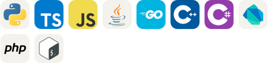</picture>

**AI and data**

<picture><source media="(prefers-color-scheme: dark)" srcset="assets/skills/rows/ai-and-data-dark.svg">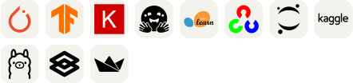</picture>

**Web, apps and games**

<picture><source media="(prefers-color-scheme: dark)" srcset="assets/skills/rows/web-apps-and-games-dark.svg"></picture>

**Databases**

<picture><source media="(prefers-color-scheme: dark)" srcset="assets/skills/rows/databases-dark.svg"></picture>

**Infrastructure and tools**

<picture><source media="(prefers-color-scheme: dark)" srcset="assets/skills/rows/infrastructure-and-tools-dark.svg">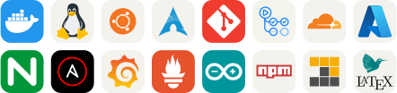</picture>

Also: SQL, NLTK, Weaviate.

## Open source Contributions of mine

<b>Used by millions</b>

- <a href="https://github.com/morluto/rea/releases/tag/rea-agents-6.6.0"> <b>rea</b></a> · Credited · Bug fixes · rea gives AI agents tools for reverse engineering software, downloaded 1.66M times a month from npm. ([d54f5b07b](https://github.com/morluto/rea/commit/d54f5b07b))
- <a href="https://github.com/NousResearch/hermes-agent/pull/145738"> <b>Hermes Agent</b></a> · Merged · Bug fixes · Nous Research's open agent that learns from experience and remembers across sessions, with 261K GitHub stars. ([#138650 credit](https://github.com/NousResearch/hermes-agent/pull/138650))
- <a href="https://github.com/NousResearch/hermes-official-plugins/pull/1"> <b>Hermes Official Plugins</b></a> · Merged · Bug fix and tests · The official plugin collection for Hermes Agent, starred 607 times on GitHub. ([#7](https://github.com/NousResearch/hermes-official-plugins/pull/7))
- <a href="https://github.com/thedotmack/claude-mem/pull/5407"> <b>Claude-Mem</b></a> · Merged · Bug fix · Claude-Mem gives Claude Code a memory that carries across sessions, with 114K GitHub stars.
- <a href="https://github.com/debpalash/VoiceStudio/pull/3827">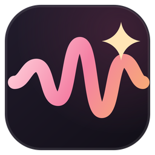 <b>VoiceStudio</b></a> · Merged · Bug fix · VoiceStudio clones voices, dubs and transcribes on your own device, with 102K GitHub stars.
- <a href="https://github.com/huggingface/huggingface_hub/pull/5285"> <b>Hugging Face Hub</b></a> · Merged · Bug fix · Hugging Face's Python client for the Hub's models and datasets, downloaded 233M times a month from PyPI.
- <a href="https://github.com/deepseek-ai/deepseek-harness/discussions/10604"> <b>DeepSeek Harness</b></a> · In progress · Bug report · DeepSeek's agent harness, where every part of an agent runs as a plugin, downloaded 2.2M times a month from npm.
- <a href="https://github.com/ollama/ollama/pull/19110"><picture><source media="(prefers-color-scheme: dark)" srcset="assets/logos/ollama-on-dark.png"></picture> <b>Ollama</b></a> · In progress · Bug fixes · Ollama runs open models on your own machine or in the cloud; its Docker image has been pulled 197M times.
- <a href="https://github.com/DietrichGebert/ponytail/pull/1363"> <b>Ponytail</b></a> · In progress · Bug fix · With 186K GitHub stars, Ponytail steers coding agents toward only the code a task needs. ([issue #1362](https://github.com/DietrichGebert/ponytail/issues/1362))
- <a href="https://github.com/openai/codex/issues/56057"> <b>Codex</b></a> · In progress · Bug report · OpenAI's coding agent for the terminal, downloaded 91M times a month from npm.
- <a href="https://github.com/matplotlib/matplotlib/pull/32539">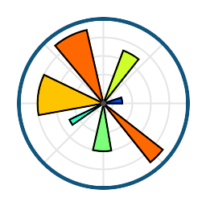 <b>Matplotlib</b></a> · In progress · Bug fix · Matplotlib makes static, animated and interactive plots in Python, downloaded 159M times a month from PyPI.
- <a href="https://github.com/huggingface/datasets/pulls?q=is%3Apr+author%3Amertkayacs"> <b>Datasets</b></a> · In progress · Bug fixes · Hugging Face's library for loading and processing machine learning datasets, downloaded 67M times a month from PyPI.
- <a href="https://github.com/anthropics/claude-agent-sdk-python/pull/1427"> <b>Claude Agent SDK</b></a> · In progress · Bug fix · Anthropic's Python SDK for building agents on Claude Code, downloaded 30M times a month from PyPI.

<b>Widely used developer tools</b>

- <a href="https://github.com/bilawalsidhu/gods-eye-view/pull/1585"> <b>God's Eye View</b></a> · Merged · Bug fix · God's Eye View puts live public data on an explorable globe, with 63K GitHub stars.
- <a href="https://github.com/Gathin23/cleanyourtv/pull/3398"> <b>CleanYourTV</b></a> · Merged · Bug fix · CleanYourTV disables unwanted software on Android TV and Google TV over Wi-Fi, starred 53K times on GitHub.
- <a href="https://github.com/musistudio/claude-code-router/pull/1871"> <b>Claude Code Router</b></a> · Merged · Bug fix · Claude Code Router sends Claude Code requests to the model provider you choose, downloaded 158K times a month from npm.
- <a href="https://github.com/NandhaKishorM/laya/pull/1466"> <b>Laya</b></a> · Merged · Bug fix · Laya turns text into choices, scores and yes-or-no answers, downloaded 272K times a month from PyPI.
- <a href="https://github.com/jarrodwatts/claude-hud/pull/802"> <b>Claude HUD</b></a> · Merged · Bug fix · Claude HUD shows Claude Code's context, tools, agents and tasks at a glance, with 29K GitHub stars.
- <a href="https://github.com/KnifeLemon/Filee/pull/1208">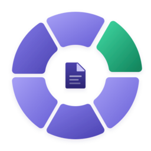 <b>Filee</b></a> · Merged · Bug fix · With 23K GitHub stars, Filee converts files between hundreds of formats offline by drag and drop.
- <a href="https://github.com/lexmount/moli/pull/2436"> <b>Moli</b></a> · Merged · Bug fix · Moli lets AI agents fetch pages and run browser tasks, with 23K GitHub stars.
- <a href="https://github.com/sirmalloc/ccstatusline/pull/695"> <b>ccstatusline</b></a> · Merged · New feature · ccstatusline puts Claude Code metrics in a customizable status line, downloaded 198K times a month from npm. ([v2.2.33](https://github.com/sirmalloc/ccstatusline/releases/tag/v2.2.33))
- <a href="https://github.com/esimov/caire/pull/114"> <b>caire</b></a> · Merged · Bug fixes · caire resizes images by content-aware seam carving, with 11K GitHub stars. ([#115](https://github.com/esimov/caire/pull/115), [#116](https://github.com/esimov/caire/pull/116), [#119](https://github.com/esimov/caire/pull/119))
- <a href="https://github.com/heygen-com/hyperframes/pull/7253">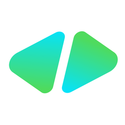 <b>HyperFrames</b></a> · In progress · Bug fix · HeyGen's HyperFrames renders HTML, CSS and animations to MP4 video, downloaded 4.2M times a month from npm.
- <a href="https://github.com/storytold/photocraft/pull/11567">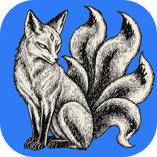 <b>PhotoCraft</b></a> · In progress · Bug fix · PhotoCraft is a native Rust editor for layered images and PSD files, with 77K GitHub stars.
- <a href="https://github.com/JustVugg/colibri/pull/2609">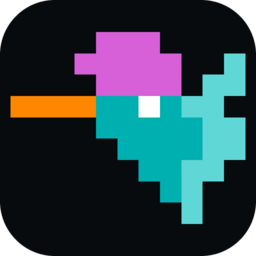 <b>colibrì</b></a> · In progress · Bug fix · colibrì runs large open mixture-of-experts models on hardware you already have, with 48K GitHub stars.
- <a href="https://github.com/sgl-project/sglang/pull/43377"> <b>SGLang</b></a> · In progress · Bug fix · SGLang is a serving framework for language, vision and diffusion models, downloaded 3.0M times a month from PyPI.
- <a href="https://github.com/QwenLM/qwen-code/pull/15144"> <b>Qwen Code</b></a> · In progress · Bug fix · The Qwen team's open-source coding agent for terminals and editors, downloaded 363K times a month from npm.
- <a href="https://github.com/storytold/pdfcraft/pull/6389"> <b>PdfCraft</b></a> · In progress · Bug fix · PdfCraft reads, organizes, merges, splits and secures PDFs in a native app, with 20K GitHub stars.
- <a href="https://github.com/EleutherAI/lm-evaluation-harness/pull/4346"> <b>LM Evaluation Harness</b></a> · In progress · Bug fix · EleutherAI's harness for testing language models across many evaluation tasks, downloaded 1.0M times a month from PyPI.

<b>Smaller projects</b>

- <a href="https://github.com/realiti4/claude-swap/pull/442"> <b>claude-swap</b></a> · Merged · Bug fix · claude-swap switches between Claude Code accounts and tracks their usage, downloaded 19K times a month from PyPI. ([v0.27.2](https://github.com/realiti4/claude-swap/releases/tag/v0.27.2))
- <a href="https://github.com/academa-labs/manimgx/pulls?q=is%3Apr+author%3Amertkayacs+is%3Amerged"> <b>ManimGX</b></a> · Merged · Bug fixes · ManimGX renders 2D and 3D animations through Manim's Python API, with 2,564 GitHub stars.
- <a href="https://github.com/errhythm/ccswap/commit/b659a4c79"> <b>ccswap</b></a> · Credited · Bug fix · ccswap switches Claude Code and Codex accounts and tracks usage, downloaded 979 times a month from PyPI.
- <a href="https://github.com/MoonshotAI/kimi-code/issues/4324"> <b>Kimi Code</b></a> · In progress · Bug report · Moonshot AI's coding agent for the terminal, downloaded 291K times a month from npm.

The full list is on [mertkayacs.com/open-source](https://mertkayacs.com/open-source/?utm_source=github&utm_medium=readme&utm_campaign=mertkayacs-repo&utm_content=open-source-link).

## Activity

<b>Contribution calendar and GitHub stats</b>

<picture>
  <source media="(prefers-color-scheme: dark)" srcset="https://raw.githubusercontent.com/mertkayacs/mertkayacs/cards/contrib-dark.svg">
  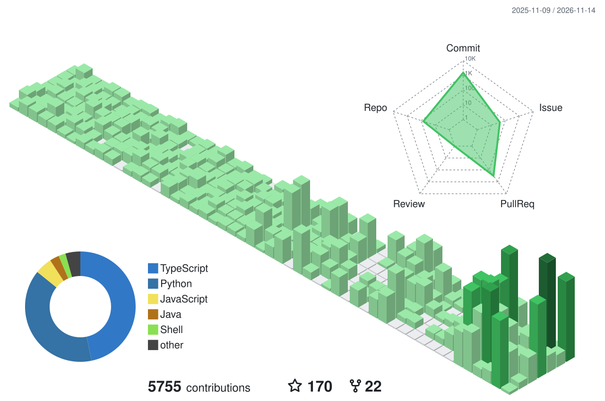
</picture>

  <picture>
    <source media="(prefers-color-scheme: dark)" srcset="https://raw.githubusercontent.com/mertkayacs/mertkayacs/cards/stats-dark.svg">
    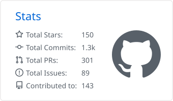
  </picture>
  <picture>
    <source media="(prefers-color-scheme: dark)" srcset="https://raw.githubusercontent.com/mertkayacs/mertkayacs/cards/languages-dark.svg">
    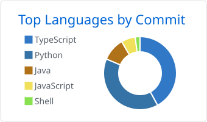
  </picture>

