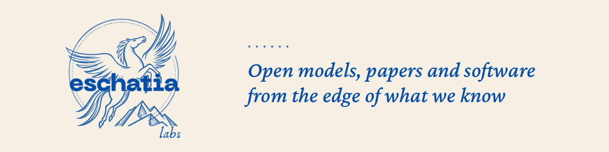

<a href="https://eschatialabs.com"><picture><source media="(prefers-reduced-motion: reduce)" srcset="assets/eschatia-labs-banner.png"></picture></a>

# Mert Kaya

Senior AI researcher and AI architect. I build small AI models and tools for decisions whose confidence and evidence people can inspect. I founded [Eschatia Labs](https://eschatialabs.com), an international open-source research lab, and work as an AI Engineer at Enocta.

[Visit my site](https://mertkayacs.com) for project demos and research. [Hugging Face](https://huggingface.co/mertkayacs) hosts the models and datasets.

## Models and evaluation

- **[JevAlt](https://github.com/mertkayacs/jevalt)**: small language models for choosing between options in English, Turkish and German, with a probability for each answer. Karar-4B is one of the best open Turkish decision models at 4B parameters: 96.8% accuracy on held-out Turkish decisions against Kev-4B's 87.1%. The tests come from JevAlt's own data pipeline. [Try the models](https://huggingface.co/spaces/mertkayacs/JevAlt).
- **[JevOss](https://github.com/mertkayacs/jevoss)**: test a decision model's accuracy, confidence and response to hidden instructions. [Test methods](https://jevoss.mertkayacs.com).
- **[Open benchmarks](https://eschatialabs.com/benchmarks/)**: [jevalt-bench](https://huggingface.co/datasets/mertkayacs/jevalt-bench) has 3,116 written situations in English, Turkish and German for decision models, and [Tholos-Bench](https://huggingface.co/datasets/mertkayacs/tholos-bench) has 160 workspace tasks for small AI assistants. Both are free to download and run against your own model.
- **[xdfdet](https://github.com/mertkayacs/xdfdet)**: eight deepfake video detectors with heatmaps showing the face regions behind a prediction, from my MSc thesis. [Study and demos](https://xdfdet.mertkayacs.com).

## Tools for AI coding and local AI

- **[Ultra Mod](https://github.com/mertkayacs/ultramod)**: an all-in-one mod pack for Claude Code. Usage limits and context above the prompt, a guard with undo for `rm -rf` and `git reset --hard`, `.env` files kept away from the model, and a receipt under every answer. Install with `npx ultramod`. [Site and demos](https://ultramod.mertkayacs.com).
- **[Tholos](https://github.com/mertkayacs/tholos)**: AI assistants that share tables, notes and tasks on your computer, with rules that allow, ask about or deny actions. Tholos-2B passed 137 of 160 Tholos-Bench scenarios against MiniCPM5-2B's 112 on a Kaggle T4 with llama.cpp and JSON schema decoding. [Model and benchmark](https://huggingface.co/mertkayacs/Tholos-2B).
- **[reevesagents](https://github.com/mertkayacs/reevesagents)**: run AI coding tools side by side in a terminal workspace, or let one direct the others. [Demo and docs](https://reevesagents.mertkayacs.com).

## Open source

Own projects:

- **[reevesagents](https://github.com/mertkayacs/reevesagents)**: run AI coding tools side by side from one local terminal workspace. 106 GitHub stars, 6,567 npm downloads.
- **[JevAlt](https://github.com/mertkayacs/jevalt)**: fixed-option decision models in English, Turkish and German, with probabilities per option. 5 GitHub stars, 4,336 Hugging Face downloads.
- **[xdfdet](https://github.com/mertkayacs/xdfdet)**: deepfake video detectors with facial-region heatmaps from my MSc thesis. 8 GitHub stars, 725 Hugging Face downloads.
- **[Tholos](https://github.com/mertkayacs/tholos)**: shared tables, notes, tasks and permission rules for local AI assistants. 1 GitHub star, 1,481 Hugging Face downloads.
- **[Ultra Mod](https://github.com/mertkayacs/ultramod)**: usage HUDs, command guards, secret masking and receipts for Claude Code. 3 GitHub stars, 1,872 npm downloads.
- **[JevOss](https://github.com/mertkayacs/jevoss)**: tests decision models for accuracy, probability quality, prompt injection and option-order sensitivity. 2 GitHub stars.
- **[tholos-bench](https://huggingface.co/datasets/mertkayacs/tholos-bench)**: 160 tool-use scenarios for testing local AI assistants. 88 Hugging Face downloads.
- **[reevesagents-skill](https://github.com/mertkayacs/reevesagents-skill)**: reevesagents instructions and setup for Claude Code, Codex and Kimi Code.
- **[Eldalambë paper](https://eschatialabs.com)**: language preservation research while the code, data and weights stay private.

Contributions by repository stars:

- **[claude-code-router](https://github.com/musistudio/claude-code-router)** (37,651): fixed a Docker redirect that exposed the management token. [PR #1871](https://github.com/musistudio/claude-code-router/pull/1871).
- **[SGLang](https://github.com/sgl-project/sglang)** (37,087): keeps Hermes streaming text in order around tool calls. [PR #43377](https://github.com/sgl-project/sglang/pull/43377).
- **[claude-hud](https://github.com/jarrodwatts/claude-hud)** (28,492): serialized cost ledger updates across processes. [PR #802](https://github.com/jarrodwatts/claude-hud/pull/802).
- **[lm-evaluation-harness](https://github.com/EleutherAI/lm-evaluation-harness)** (14,208): keeps question whitespace intact in the `mmlu_cot_llama` prompt. [PR #4346](https://github.com/EleutherAI/lm-evaluation-harness/pull/4346).
- **[ccstatusline](https://github.com/sirmalloc/ccstatusline)** (13,272): added spend-limit usage widgets for developers behind a gateway. [PR #695](https://github.com/sirmalloc/ccstatusline/pull/695).
- **[huggingface_hub](https://github.com/huggingface/huggingface_hub)** (3,983): accepted dataclass validators with `*args` or `**kwargs`. [PR #5131](https://github.com/huggingface/huggingface_hub/pull/5131).
- **[claude-swap](https://github.com/realiti4/claude-swap)** (3,403): creates the temporary JSON file with owner-only permissions from the start. [PR #442](https://github.com/realiti4/claude-swap/pull/442).
- **[hermes-official-plugins](https://github.com/NousResearch/hermes-official-plugins)** (266): fixed Home Assistant registration parsing and expanded Spotify client tests. [PR #1](https://github.com/NousResearch/hermes-official-plugins/pull/1), [PR #7](https://github.com/NousResearch/hermes-official-plugins/pull/7), [PR #8](https://github.com/NousResearch/hermes-homeassistant/pull/8), [PR #12](https://github.com/NousResearch/hermes-spotify/pull/12).

[Full live open-source list](https://mertkayacs.com/open-source/).

## Research

MSc Computer Science, TED University. BSc Computer Engineering, TOBB University of Economics and Technology.

- M. Kaya, V. Adanova. *Augmentation and Cutout in Deepfake Detection: A Comparative Study of Accuracy, Calibration, and Attention.* UBMK 2026. Accepted, to appear in IEEE Xplore.
- M. Kaya. *Explainable deepfake detection using frame level CNN models: A comparative study of augmentation and cutout techniques.* MSc thesis, TED University, 2025. Advisor: V. Adanova. [Read the thesis](https://doi.org/10.5281/zenodo.18998566).
- M. Kaya. *Language Preservation Using Agentic AI Architectures: A Tool-Grounded Small Language Model on a Constructed-Language Testbed.* Preprint, Eschatia Labs, 2026. [Read the paper](https://eschatialabs.com/research/eldalambe-2026/).

[LinkedIn](https://www.linkedin.com/in/mertkayacs) and [Kaggle](https://www.kaggle.com/mertilovski).
