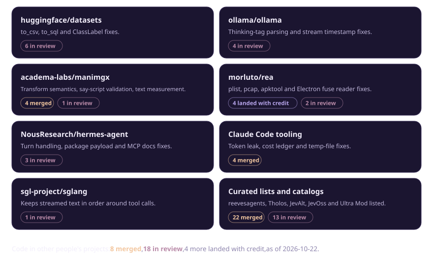
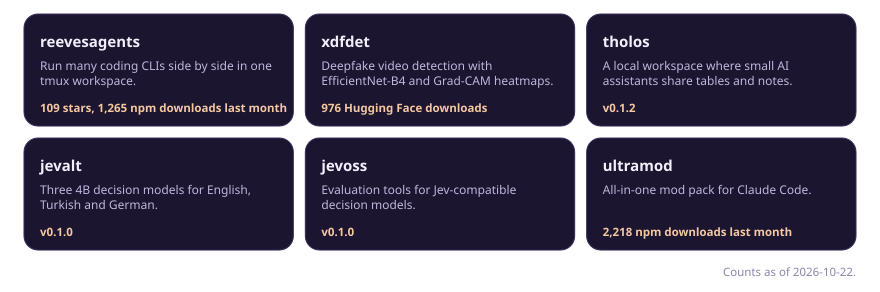

<picture>
  <source media="(prefers-color-scheme: dark)" srcset="assets/banner-dark.svg">
  <source media="(prefers-color-scheme: light)" srcset="assets/banner-light.svg">
  
</picture>

Founder of [Eschatia Labs](https://eschatialabs.com), an independent, non-profit open-source AI research lab. I build open tools and small models, and I fix the libraries I rely on.

## Open source

<picture>
  <source media="(prefers-color-scheme: dark)" srcset="assets/oss-dark.svg">
  <source media="(prefers-color-scheme: light)" srcset="assets/oss-light.svg">
  
</picture>

## Projects

<picture>
  <source media="(prefers-color-scheme: dark)" srcset="assets/projects-dark.svg">
  <source media="(prefers-color-scheme: light)" srcset="assets/projects-light.svg">
  
</picture>

[reevesagents](https://github.com/mertkayacs/reevesagents) | [xdfdet](https://github.com/mertkayacs/xdfdet) | [tholos](https://github.com/mertkayacs/tholos) | [jevalt](https://github.com/mertkayacs/jevalt) | [jevoss](https://github.com/mertkayacs/jevoss) | [ultramod](https://github.com/mertkayacs/ultramod)

## Links

[mertkayacs.com](https://mertkayacs.com) | [eschatialabs.com](https://eschatialabs.com) | [Hugging Face](https://huggingface.co/mertkayacs) | [X @mertkayaai](https://x.com/mertkayaai) | [Full open-source list](https://mertkayacs.com/open-source/)
