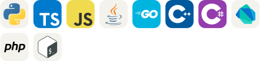
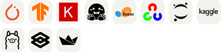

I'm a senior AI engineer at Enocta and the founder of [Eschatia Labs](https://eschatialabs.com), an independent, non-profit open-source AI research lab. I build small models that run on a laptop, agents you can inspect and detectors that show their evidence.

## Career

- **Senior AI Engineer**, Enocta, since 2025. Assistants that answer from company documents (RAG), an agentic customer-success workflow, role-play training simulations.
- **Full-stack and Mobile Engineer**, Credit Bureau of Turkey (KKB), 2023-2024. Financial software used across the Turkish banking sector: backend, mobile and system design.
- **AI and Full-stack Engineer**, AgriDL5.0, 2022-2023 (contract). Models that predict growing conditions in vertical farms, plus the Flutter app on top.
- **Backend and Data Engineer**, Alictus, 2021-2022. Moved internal tools to the cloud with Go and Azure.
- **Internships** at SimBT, BiSoft and Roar Games Studio, 2019-2021. Defence technology software, an NLTK and Neo4j chatbot before LLMs, Unity and C# games.

## Projects

- **[Emberwick](https://emberwick.mertkayacs.com)**: A medieval village you play in the browser. Three small decision models decide what the villagers do through storms, fires, markets and wolves.
- **[reevesagents](https://github.com/mertkayacs/reevesagents)**: Run Claude Code, Codex and 20+ other coding assistants side by side in one terminal, with one of them coordinating the rest. CLI, TUI, Web UI and MCP server. 107 stars, 2,375 npm downloads a month.
- **[JevAlt](https://github.com/mertkayacs/jevalt)**: The three 4B decision models behind Emberwick, for English, Turkish and German. Calibrated answers on a laptop with about 3 GB of memory. 3,505 Hugging Face model downloads.
- **[xdfdet](https://github.com/mertkayacs/xdfdet)**: Explainable deepfake detection: eight EfficientNet-B4 models with Grad-CAM evidence, the code behind my thesis and conference paper. 1,133 Hugging Face downloads.
- **[Tholos](https://github.com/mertkayacs/tholos)**: Small local assistants that share tables, notes and a task board, every action behind a rule. Its model, Tholos-2B: 2,248 Hugging Face downloads.
- **[Ultra Mod](https://github.com/mertkayacs/ultramod)**: The all-in-one mod pack for Claude Code. 2,224 npm downloads a month.

Download counts from 25 October 2026: 10,341 on Hugging Face (6,886 for my models, 3,455 for my datasets) and 10,018 for my npm packages.

## Stack

**Languages**

<picture><source media="(prefers-color-scheme: dark)" srcset="assets/skills/rows/languages-dark.svg"></picture>

**AI and data**

<picture><source media="(prefers-color-scheme: dark)" srcset="assets/skills/rows/ai-and-data-dark.svg"></picture>

**Web, apps and games**

<picture><source media="(prefers-color-scheme: dark)" srcset="assets/skills/rows/web-apps-and-games-dark.svg"></picture>

**Databases**

<picture><source media="(prefers-color-scheme: dark)" srcset="assets/skills/rows/databases-dark.svg"></picture>

**Infrastructure and tools**

<picture><source media="(prefers-color-scheme: dark)" srcset="assets/skills/rows/infrastructure-and-tools-dark.svg"></picture>

Also: SQL, NLTK, Weaviate.

## Education and research

- **MSc Computer Science**, TED University, 2023-2025, full merit scholarship. Thesis: [Explainable deepfake detection using frame level CNN models: A comparative study of augmentation and cutout techniques](https://doi.org/10.5281/zenodo.18998566), advised by Professor Venera Adanova.
- **MSc Computer Science and AI**, IU International University of Applied Sciences, 2022-2023, full scholarship, remote. One year before I moved to TED University.
- **BSc Computer Engineering**, TOBB University of Economics and Technology (TOBB ETU), 2016-2021.
- **UBMK 2026 (IEEE)**, [Augmentation and Cutout in Deepfake Detection: A Comparative Study of Accuracy, Calibration, and Attention](https://mertkayacs.com/research/), with Professor Venera Adanova. Presented at the 11th International Conference on Computer Science and Engineering in Istanbul, September 2026. To appear in IEEE Xplore.

## Open source

**Merged**

- <a href="https://github.com/musistudio/claude-code-router/pull/1871"> <b>Claude Code Router</b></a> · Merged · Stopped the Docker setup from handing the management token to unauthenticated clients.
- <a href="https://github.com/realiti4/claude-swap/pull/442"> <b>claude-swap</b></a> · Merged · Created the temporary JSON file with owner-only permissions from the start. ([v0.27.2 release notes](https://github.com/realiti4/claude-swap/releases/tag/v0.27.2))
- <a href="https://github.com/esimov/caire/pull/114"> <b>caire</b></a> · Merged · Kept transparency when enlarging images and rejected masks with the wrong dimensions. ([#115](https://github.com/esimov/caire/pull/115), [#116](https://github.com/esimov/caire/pull/116), [#119](https://github.com/esimov/caire/pull/119))
- <a href="https://github.com/academa-labs/manimgx/pulls?q=is%3Apr+author%3Amertkayacs+is%3Amerged"> <b>ManimGX</b></a> · Merged · Fixed text sizing, script validation and scene setup in a Manim-based video engine.
- <a href="https://github.com/NousResearch/hermes-official-plugins/pull/1"> <b>Hermes Official Plugins</b></a> · Merged · Fixed Home Assistant control and expanded Spotify client tests. ([#7](https://github.com/NousResearch/hermes-official-plugins/pull/7))
- <a href="https://github.com/NousResearch/hermes-agent/pull/145738"> <b>Hermes Agent</b></a> · Merged · Fixed image installs that were missing their sealed payloads. (earlier credit: [#138650](https://github.com/NousResearch/hermes-agent/pull/138650))
- <a href="https://github.com/jarrodwatts/claude-hud/pull/802"> <b>Claude HUD</b></a> · Merged · Kept cost totals correct when several sessions update them at once.
- <a href="https://github.com/sirmalloc/ccstatusline/pull/695"> <b>ccstatusline</b></a> · Merged · Added spend-limit usage widgets for developers behind a gateway.

**Credited**

- <a href="https://github.com/morluto/rea/releases/tag/rea-agents-6.6.0"> <b>rea</b></a> · Credited · Fixed number, timestamp and locale parsing in a reverse-engineering toolkit, with the 6.6.0 release notes naming me.
- <a href="https://github.com/errhythm/ccswap/commit/b659a4c79"> <b>ccswap</b></a> · Credited · Carried the owner-only temp file fix into a downstream account manager.

**In progress**

- <a href="https://github.com/QwenLM/qwen-code/pull/15144"> <b>Qwen Code</b></a> · In progress · Kept files behind path deny rules out of grep and glob results.
- <a href="https://github.com/huggingface/datasets/pulls?q=is%3Apr+author%3Amertkayacs"> <b>Hugging Face datasets</b></a> · In progress · Fixed CSV and SQL exports, label casting and row indexing in the datasets library.
- <a href="https://github.com/sgl-project/sglang/pull/43377"> <b>SGLang</b></a> · In progress · Kept Hermes streaming text in order around tool calls.
- <a href="https://github.com/ollama/ollama/pulls?q=is%3Apr+author%3Amertkayacs"><picture><source media="(prefers-color-scheme: dark)" srcset="assets/logos/ollama-on-dark.png"></picture> <b>Ollama</b></a> · In progress · Kept streamed thinking in order and images with their text in API requests.
- <a href="https://github.com/anthropics/claude-agent-sdk-python/pull/1427"> <b>Claude Agent SDK</b></a> · In progress · Stopped tool inputs from renaming sessions.
- <a href="https://github.com/EleutherAI/lm-evaluation-harness/pull/4346"> <b>LM Evaluation Harness</b></a> · In progress · Kept question whitespace in the mmlu_cot_llama prompt.
- <a href="https://github.com/openai/codex/issues/56057"> <b>Codex</b></a> · In progress · Made the JSON server details include the configured required flag.
- <a href="https://github.com/deepseek-ai/deepseek-harness/discussions/10604"> <b>DeepSeek Harness</b></a> · In progress · Made --dump-config show telemetry as disabled when it is disabled.
- <a href="https://github.com/MoonshotAI/kimi-code/issues/4324"> <b>Kimi Code</b></a> · In progress · Fixed log size limits so 10 MB no longer becomes 10 bytes.

The full list is on [mertkayacs.com/open-source](https://mertkayacs.com/open-source/).

## Activity

<picture>
  <source media="(prefers-color-scheme: dark)" srcset="https://raw.githubusercontent.com/mertkayacs/mertkayacs/cards/contrib-dark.svg">
  
</picture>

  <picture>
    <source media="(prefers-color-scheme: dark)" srcset="https://raw.githubusercontent.com/mertkayacs/mertkayacs/cards/stats-dark.svg">
    
  </picture>
  <picture>
    <source media="(prefers-color-scheme: dark)" srcset="https://raw.githubusercontent.com/mertkayacs/mertkayacs/cards/languages-dark.svg">
    
  </picture>

## Elsewhere

[mertkayacs.com](https://mertkayacs.com) | [eschatialabs.com](https://eschatialabs.com) | [Hugging Face](https://huggingface.co/mertkayacs) | [Kaggle](https://www.kaggle.com/mertilovski) | [LinkedIn](https://www.linkedin.com/in/mertkayacs) | [ORCID](https://orcid.org/0009-0006-7018-3027) | [X](https://x.com/mertkayaai)
